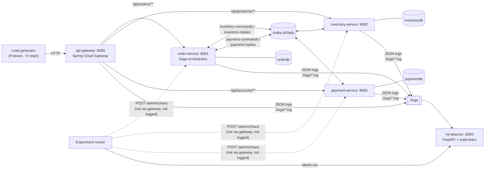
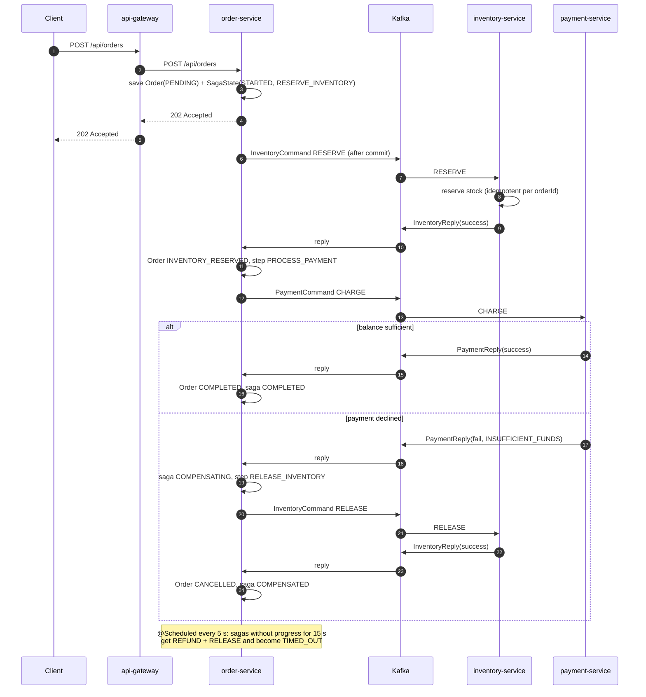
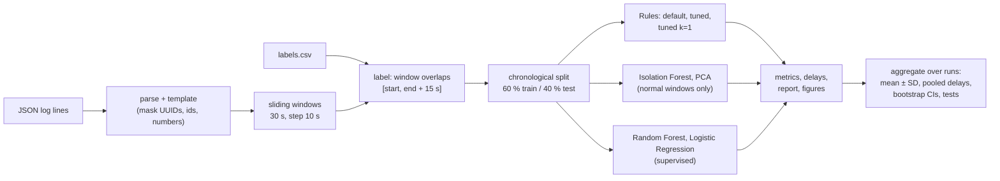

# Lightweight ML vs Rule-Based Anomaly Detection in Backend Application Logs

Code for the master's thesis **"A Comparative Evaluation of Lightweight Machine Learning and
Rule-Based Methods for Anomaly Detection in Backend Application Logs"** by Phearom CHEA.

The project has two parts:

- **A. A microservice system** (Java 21, Spring Boot 3.3, Spring Cloud 2023.0) that processes
  orders with an orchestrated **Saga**, writes structured JSON logs with trace ids, and can
  **inject faults on purpose**. The logs show only the symptoms of a fault, never the fault itself.
- **B. A Python ML detector** that turns those logs into sliding-window features and compares a
  **rule-based baseline**, **Isolation Forest** and **Random Forest** against the ground-truth
  fault labels written by the experiment runner.

| Research question | Answered by |
|---|---|
| **Q1** How accurately can ML detect anomalies in backend logs? | Precision, Recall, F1, ROC-AUC on held-out test windows |
| **Q2** How do Rule-Based, Isolation Forest and Random Forest compare? | The same metrics plus false-positive rate and false-alarm episodes per method, on identical windows |
| **Q3** Can log-based ML detect problems earlier than rule-based monitoring? | Per-fault detection delay and an earlier / same / later comparison against the rules |

---

## 1. Architecture



- One PostgreSQL 16 instance with **one database per service** (`orderdb`, `inventorydb`, `paymentdb`).
- **Micrometer Tracing (Brave)** puts `traceId`/`spanId` in every log line and propagates them over
  HTTP and Kafka (`spring.kafka.template.observation-enabled` / `listener.observation-enabled`).
  One order produces a single trace across the gateway, order, inventory and payment logs.
- Every service logs JSON (logstash-logback-encoder) to the console and to `${LOG_DIR}/<service>.log`
  (rolling, asynchronous), with the custom field `service`.

### Log format

```json
{"@timestamp":"2026-11-08T03:49:05.944Z","@version":"1",
 "message":"HTTP request event=http_request method=GET path=/api/orders/{id} status=200 durationMs=11",
 "logger_name":"com.thesis.common.logging.AccessLogFilter","thread_name":"http-nio-8081-exec-4",
 "level":"INFO","level_value":20000,"service":"order-service",
 "traceId":"6aeff131ecfd53e34ce69867da20ad3b","spanId":"ac1975c6ef5a3da1",
 "event":"http_request","method":"GET","path":"/api/orders/{id}","status":200,"durationMs":11}
```

Business fields are written with `StructuredArguments.kv(...)`, so they appear both inside the
message and as JSON fields. Unexpected exceptions add `stack_trace`.

| Event | Service | Meaning |
|---|---|---|
| `http_request` | all | one access-log line per request (INFO / WARN 4xx / ERROR 5xx); ids in paths become `{id}` |
| `unhandled_exception` | servlet services | exception reached the global handler (logged with stack trace, RFC 7807 response) |
| `saga_started`, `saga_step`, `saga_completed` | order | the saga's normal path |
| `saga_failed`, `saga_compensating`, `saga_compensated` | order | business failure / compensation (INFO for business reasons, WARN for technical ones) |
| `saga_timeout`, `saga_late_reply` | order | stuck saga compensated by the scheduler; a reply arriving after that |
| `message_processed`, `message_failed` | all Kafka consumers | one line per message attempt, with `durationMs` |
| `message_retries_exhausted`, `message_dropped` | Kafka consumers | retries used up |
| `stock_reserved`, `stock_released`, `stock_rejected`, `payment_charged`, `payment_declined`, `payment_refunded` | participants | participant business events |

---

## 2. The order saga

The order service is an **orchestrator**: it stores the saga state and tells each participant
what to do through Kafka commands. Commands are sent **only after the database transaction has
committed** (`TransactionSynchronization.afterCommit`), so a participant never acts on state that
was rolled back.



| Step | Command (participant) | On success | On failure | Compensation |
|---|---|---|---|---|
| 1 Reserve inventory | `RESERVE` (inventory) | step → `PROCESS_PAYMENT`, order `INVENTORY_RESERVED` | saga `FAILED`, order `CANCELLED` (`OUT_OF_STOCK`, `PROCESSING_ERROR`, …) | nothing reserved, nothing to undo |
| 2 Process payment | `CHARGE` (payment) | saga `COMPLETED`, order `COMPLETED` | saga `COMPENSATING` | `RELEASE` inventory → saga `COMPENSATED`, order `CANCELLED` |
| Timeout (any step) | – | – | no reply within `SAGA_TIMEOUT_MS` (15 s) | `REFUND` + `RELEASE`, saga `TIMED_OUT`, order `CANCELLED` (`SAGA_TIMEOUT`) |
| Late reply | – | – | success reply for a finished saga (`saga_late_reply`) | `RELEASE` (late reserve) or `REFUND` (late charge) |

**Idempotency and races.** Inventory keeps one `Reservation` and payment one `Payment` per
`orderId`, so repeated commands return the same answer. When a compensation overtakes the
original command (`RELEASE` before `RESERVE`, `REFUND` before `CHARGE`) the participant stores a
tombstone, so the late command is rejected instead of leaking stock or money. Stock and balances
are updated under a row lock (`PESSIMISTIC_WRITE`); the entities also carry `@Version`.

**Kafka error handling.** Order service: 3 retries one second apart, then the reply is dropped
(the timeout compensates). Participants: 2 retries, then the orchestrator receives
`success=false, reason=PROCESSING_ERROR`.

**Business noise.** Customers C-007 and C-014 are seeded with a balance of 50, so a share of
payments is declined and compensated during normal operation. Out-of-stock can also happen. This
is ordinary behaviour, not an anomaly, and it makes the detection task realistic.

---

## 3. Fault injection

Every servlet service exposes `/admin/chaos` (from the `common` module):

```bash
curl -X POST localhost:8082/admin/chaos -H 'Content-Type: application/json' \
     -d '{"type":"DB_TIMEOUT","latencyMs":3000,"errorRate":0.4,"durationSec":120}'
curl localhost:8082/admin/chaos            # status
curl -X DELETE localhost:8082/admin/chaos  # clear early
```

Business code calls `chaos.apply("operation")` before its database work. A fault **expires by
itself** after `durationSec`. `/admin` is not routed through the gateway and is excluded from the
access log, the chaos code writes no log lines, and the injector's own frames are removed from
the stack traces it causes, so **the logs show only symptoms**.

| Type | What happens | Symptoms in the logs |
|---|---|---|
| `LATENCY` | every operation sleeps `latencyMs` ± 25 % | higher `durationMs` in access logs and `message_processed`; Kafka backlog; `saga_timeout`/`saga_late_reply` when replies take over 15 s; gateway 504 above 10 s |
| `ERROR` | each operation throws a realistic exception with probability `errorRate` (connection failure, lock timeout, socket timeout, connection reset, NPE) | `unhandled_exception` with stack trace, HTTP 500 (also at the gateway), `message_failed` + retries, `PROCESSING_ERROR` → failed/compensated sagas, new message templates |
| `DB_TIMEOUT` | sleeps `latencyMs` ± 25 %, then with probability `errorRate` throws `QueryTimeoutException: JDBC query timeout … HikariPool-1 - Connection is not available … (Total=10, Active=10, Idle=0, Waiting=N)` | a mix of both: slow requests, connection-pool timeout stack traces, 500s, retries and saga timeouts |

The experiment runner chooses severities from these presets:

| Type | low | medium | high |
|---|---|---|---|
| LATENCY | 400 ms | 1200 ms | 3000 ms |
| ERROR | 10 % | 30 % | 60 % |
| DB_TIMEOUT | 1500 ms, 20 % | 3000 ms, 40 % | 6000 ms, 70 % |

---

## 4. How to run

Requirements: Docker with Compose v2. For local development: JDK 21, Maven 3.9, Python 3.12.

### 4.1 Start the system

```bash
docker compose up -d --build
```

```bash
docker compose ps
```

```bash
curl -X POST localhost:8080/api/orders -H 'Content-Type: application/json' \
     -d '{"customerId":"C-001","productId":"P-101","quantity":2}'
```

Logs are written to `./logs/<service>.log`.

Three web pages come with the system:

| Page | Address | What it does |
|---|---|---|
| **Shop** | <http://localhost:8080> | choose a customer, order products, watch each order go through the saga (stock reserved → payment charged → completed, or cancelled with the reason) |
| **Anomaly monitor** | <http://localhost:8000> | service health and active faults, fault injection with the experiment presets, the score of each detector over the last 30 minutes, the latest window with its explanation, recent alerts, and every experiment run with buttons to evaluate it or train the live detector on it, plus links to its report and figures |
| **Database** (Adminer) | <http://localhost:8090> | browse and query the three databases: log in with System *PostgreSQL*, Server `postgres`, Username and Password `postgres`, Database `orderdb`, `inventorydb` or `paymentdb` |

Close the shop while an experiment runs: its requests are real traffic in the logs. The monitor
refuses manual faults while an experiment runs, because they would not be in its labels.
Browsing the database is safe during an experiment: it does not go through the services, so it
adds nothing to the logs.

In Adminer, *select <table>* in the left menu shows the rows, *SQL command* runs any query. Useful
tables: `orders` and `saga_state` (orderdb), `products` and `reservations` (inventorydb),
`accounts` and `payments` (paymentdb). For example, how the sagas ended:

```sql
select status, failure_reason, count(*) from orders group by status, failure_reason order by count(*) desc;
```

A desktop tool (DBeaver, pgAdmin, DataGrip) works too: host `localhost`, **port 5433**, user and
password `postgres`. Adminer is reachable only from this computer (`127.0.0.1`).

### 4.2 Run an experiment

```bash
docker compose --profile experiment run --rm experiment \
    --duration-min 180 --warmup-min 10 --rps 5 --seed 42 --out /results
```

The runner waits until every service is healthy, sends warm-up traffic, then repeatedly injects
a random fault (random service, type and severity, 60–180 s) followed by a normal gap of
180–420 s. It writes `./results/labels.csv` (`fault_id, service, type, start, end, params`, ISO-8601
UTC) and `./results/experiment.json` (configuration, load start/end, load statistics).

**Run one experiment at a time.** Two runs in parallel would inject faults into the same
services, and each run's labels would miss the other's faults. A lock file
`results/.experiment-running` makes a second run refuse to start; it is removed when a run ends
(if a run was killed, delete it by hand). The evaluation refuses a run that is still going (no
`experiment.json` yet) or was stopped early; `--allow-incomplete` overrides this.

### 4.3 Evaluate

Through the detector's API:

```bash
curl -X POST localhost:8000/evaluate -H 'Content-Type: application/json' -d '{"train_frac":0.6}'
```

Or from the command line:

```bash
cd ml-detector && python -m detector.cli evaluate --logs ../logs --labels ../results/labels.csv \
    --out ../results/detector --window 30 --step 10 --train-frac 0.6
```

Outputs in `results/detector/`: `results.json`, `report.md`, `detection_delays.csv`,
`window_predictions.csv`, `timeline.png`, `metrics.png`, `detection_delay.png`. The command line
compares seven methods (see section 5); the API returns the original three unless the request
sets `"tune_rules": true` or `"methods": [...]`. Several runs, statistics and cross-run checks:
section 6.

If `experiment.json` sits next to `labels.csv`, only logs from the period when the load generator
ran are evaluated, which keeps service start-up noise out of the data (override with `--start`/`--end`).

### 4.4 Live detection

```bash
curl -X POST localhost:8000/train -H 'Content-Type: application/json' -d '{}'
```

```bash
curl localhost:8000/detect
```

```bash
curl localhost:8000/alerts
```

`/train` fits Isolation Forest (and Random Forest if labels exist) on the logs and saves the model
to `./models`. A background loop tails `./logs` every 10 s, scores the newest window with every
available method and records alerts. The rules work without training.

Every alert carries an **explanation**: the suspected service, the kind of problem (slow
responses → like LATENCY, errors → like ERROR, both → like DB_TIMEOUT), the features that deviate
most from their normal level (learned from the normal training windows), and real error lines
from the logs of that window. On the 7 faults of a real 30-minute test run, and on synthetic
faults, it named the injected service and fault type correctly every time.

### 4.5 Telegram alerts

The detector can send each incident to Telegram: **one message when a problem starts** (with the
explanation) and **one when it is resolved** (no alert for 60 s). It does not send a message for
every 10-second window.

1. In Telegram, open **@BotFather**, send `/newbot` and follow the steps. Copy the **token**.
2. Open your new bot and send it any message (e.g. `hi`).
3. Find your **chat id**: open `https://api.telegram.org/bot<TOKEN>/getUpdates` in a browser and
   copy the number at `"chat":{"id": ...}`.
4. Copy `.env.example` to `.env` (it is git-ignored) and fill in `TELEGRAM_BOT_TOKEN` and
   `TELEGRAM_CHAT_ID`.
5. Recreate the detector so it reads the new settings, then send a test message:

```bash
docker compose up -d ml-detector
```

```bash
curl -X POST localhost:8000/notify/test
```

`NOTIFY_METHODS` chooses which detectors may notify (default: all three);
`NOTIFY_RESOLVE_AFTER_S` sets when an incident counts as resolved.

Example message:

```
🚨 Anomaly detected (incident #3)
Time: 2026-11-08 04:14:40 UTC
Detected by: Random Forest (0.94), Isolation Forest (0.82)

Suspected service: inventory-service
Suspected problem: slow responses and errors (database or connection problem, like DB_TIMEOUT)

Strongest signals:
• inventory-service: p95 latency (ms) = 7154 ms (normal ≈ 5 ms)
• inventory-service: Kafka message p95 (ms) = 7128 ms (normal ≈ 6 ms)
• system: saga timeouts = 85 (normal ≈ 0)

Example log lines:
• [inventory-service] Unhandled exception event=unhandled_exception path=/api/products
  exception=QueryTimeoutException errorMessage=JDBC query timeout after 5600ms during
  listProducts; HikariPool-1 - Connection is not available, request time…
```

### 4.6 Without Docker

```bash
mvn -B package
```

The services need PostgreSQL and Kafka (`DB_URL`, `DB_USER`, `DB_PASSWORD`, `KAFKA_BOOTSTRAP`,
`LOG_DIR`; defaults point to `localhost`). The detector can be tried on synthetic logs, with no
services running:

```bash
cd ml-detector && pip install -r requirements-dev.txt
```

```bash
python -m detector.cli synth --out ./synthetic --duration-min 120 --seed 1
```

```bash
python -m detector.cli evaluate --logs ./synthetic/logs --labels ./synthetic/labels.csv --out ./synthetic/eval
```

> Synthetic logs use the same JSON format, and their faults ramp up gradually. They exist **only
> to test the code**; do not report results from them in the thesis.

---

## 5. ML pipeline



**Parsing (`parsing.py`).** Each line becomes a row with time, service, level, event, HTTP fields,
`durationMs` and whether it has a stack trace. The message is reduced to a **template** by masking
UUIDs, timestamps, IPs, business ids (`P-100`, `C-007`), long hex strings and numbers.
`LogTailer` reads files incrementally for live detection (it handles partial lines and rotation).

**Features (`features.py`), per window.** For each of the four services:

| Feature | Description |
|---|---|
| `log_count`, `error_count`, `warn_count`, `error_ratio` | volume and severity of log lines |
| `http_count`, `http_4xx`, `http_5xx`, `http_5xx_ratio` | from `event=http_request` |
| `latency_mean`, `latency_p95`, `latency_max` | HTTP `durationMs` |
| `kafka_p95` | p95 `durationMs` of `message_processed` / `message_failed` |
| `exception_count` | lines with a stack trace |
| `distinct_templates` | number of different templates |

System-wide: counts of `saga_started`, `saga_completed`, `saga_failed`, `saga_compensating`,
`saga_compensated`, `saga_timeout`, `saga_late_reply`; `saga_success_ratio` (completed / started,
1.0 when nothing started); `unseen_templates` (WARN/ERROR lines whose template never appeared in
the **normal training** logs, which catches new exception messages). New INFO messages are not
counted: a request type the training traffic never made is a change in usage, not a failure,
and counting it caused false alarms as soon as the system was used differently, e.g. through
the shop.

**Labels.** A window is anomalous if it overlaps `[fault start, fault end + 15 s]`. The grace period
covers symptoms that outlast the fault (queued Kafka messages, retries, timeouts).

**Detectors (`models.py`).** All share `fit(X, y)`, `score(X)` (higher = more anomalous, used
for ROC-AUC) and `predict(X)` (0/1 alert per window).

| Method (key) | Training | Details |
|---|---|---|
| Rule-based, default (`rules`) | none | gateway 5xx ratio > 5 % (with ≥ 10 requests), gateway p95 > 2000 ms, > 10 ERROR lines in any service; a rule must hold for **3 consecutive windows** (like Prometheus `for:`). Score = max over rules of min(value/threshold) over the last 3 windows. |
| Rule-based, tuned (`rules_tuned`) | training windows + labels | the same rules; thresholds **and** `consecutive` chosen by grid search on the **training windows only**: `consecutive` ∈ {1, 2, 3}, 5xx ratio ∈ {0.02, 0.05, 0.10}, p95 ∈ {1000, 2000, 3000} ms, ERROR lines ∈ {3, 5, 10} (81 settings). Best training F1 wins; ties go to fewer false-alarm episodes, then to grid order. |
| Rule-based, tuned k=1 (`rules_tuned_k1`) | as above | the tuned thresholds with `consecutive = 1`, so the rules alert on a single window like the ML models (no built-in `for:` delay) |
| Isolation Forest (`isolation_forest`) | normal training windows only | symptom features only (ratios, latencies, error/exception counts, saga timeouts and success ratio, unseen templates; no raw traffic volume), `log1p` + `StandardScaler`, 300 trees; alert threshold = 97th percentile of training scores |
| Random Forest (`random_forest`) | all training windows + labels | every feature, 300 trees, `class_weight="balanced"`, threshold 0.5; feature importance reported |
| PCA reconstruction (`pca`) | normal training windows only | the Isolation Forest symptom features, `log1p` + `StandardScaler`, components explaining 95 % of the variance; score = squared reconstruction error; threshold = the same 97th-percentile rule as Isolation Forest |
| Logistic Regression (`logistic_regression`) | all training windows + labels | every feature, `log1p` + `StandardScaler`, `class_weight="balanced"`, threshold 0.5; the 20 largest standardised coefficients are reported |

The chosen rule thresholds, the ten best grid points and a **grid-edge check** are written to
`results.json → rule_tuning` and to the "Rule variants" section of `report.md`. The grid-edge
check flags a tuned threshold that sits on the edge of the grid while the next value inward
scores worse, i.e. where a better value may lie outside the grid. The live detector (API,
alerts, Telegram) keeps using `rules`, Isolation Forest and Random Forest.

**Evaluation (`evaluate.py`).** Windows that end before the split point train, windows that start
after it test, and windows crossing it are dropped, so no overlapping window leaks across. The
template vocabulary for `unseen_templates` comes only from normal training logs, and the rules are
tuned on the training windows only.

| Metric | Definition |
|---|---|
| Precision / Recall / F1 | per test window |
| ROC-AUC | from each method's continuous score |
| False-positive rate | FP / (FP + TN) |
| False-alarm episodes | runs of consecutive alerting windows that contain no anomalous window (also per hour) |
| Detection delay | end of the first alerting window that overlaps the fault − fault start (only faults that start in the test period) |
| Comparison vs rules | per fault and per rule variant: ML **earlier** (or ML detected and the rule missed), **same**, **later or missed**, **both missed**; mean/median time saved over faults detected by both |
| Breakdowns | detection rate and mean delay by fault type and by target service |

Note on delay resolution: alerts happen at window ends, every 10 s. The default rules need three
windows in a row, so their earliest possible delay is about 20 s after the first symptomatic
window; `rules_tuned_k1` has no such delay. **Base the Q3 conclusion on the tuned variants.**

`evaluate` options: `--window`, `--step`, `--train-frac`, `--grace`, `--seed`, `--start`/`--end`,
`--methods` (comma-separated subset; the default rules are always included), `--no-rule-tuning`
(only the original three methods), `--no-figures`, `--allow-incomplete`, `--json`.

**Several runs (`aggregate.py`).** `python -m detector.cli aggregate --runs <run folders or glob>
--out <dir>` reads `detector/results.json`, `detection_delays.csv` and `window_predictions.csv` of
every run. It refuses runs evaluated with different window, step, train fraction or grace.

| Output | Content |
|---|---|
| `summary_metrics.csv` / `.md` | per method: mean ± sample SD over runs of Precision, Recall, F1, ROC-AUC, FPR, false alarms per hour |
| `pooled_delays.csv` | one row per test-period fault × method from all runs: run id, fault id, type, severity, service, detected, delay |
| `summary_q3.md` | pooled detection rate, mean and median delay; earlier / same / later counts of every ML model against every rule variant; both also by fault type and by severity |
| `stats.md`, `stats_tests.csv` | statistical tests (below), one plain-English line per hypothesis |
| `ci_f1.csv`, `ci_delay.csv` | 95 % bootstrap confidence intervals |
| `f1_by_method.png` | F1 per method, mean with ±1 SD error bars and one dot per run (300 dpi) |
| `pooled_delays.png` | box plot of pooled delays per method (300 dpi) |
| `detection_rate_by_type.png` | detection rate by fault type × method (300 dpi) |

**Statistics (`stats.py`).** α = 0.05; 2,000 bootstrap resamples, seed 42 (`--bootstrap`, `--seed`).

- **F1 confidence interval**: cluster bootstrap. Each test window belongs to the fault that most
  recently started (the fault plus the normal gap after it); clusters are resampled within each
  run, and F1 is computed from the summed TP / FP / FN. Runs evaluated before
  `window_predictions.csv` existed fall back to resampling runs, which the table states.
- **Mean-delay confidence interval**: faults resampled within each run; mean over detected faults.
- **McNemar's exact test** on per-fault detection, each ML model vs each tuned rule variant
  (only faults detected by exactly one of the two count).
- **Wilcoxon signed-rank test** on the delays of faults detected by both; differences are
  rule − ML (positive = ML earlier), zero differences are dropped, normal approximation with tie
  correction; n, median difference and effect size r = |Z| / √n are reported.
- **Holm correction** over all tests. A test with fewer than 6 informative faults is reported as
  "not tested" instead of a p-value. If `rules_tuned_k1` made exactly the same per-fault alerts
  as `rules_tuned`, its tests are not repeated.

**Generalisation (`cross`).** `python -m detector.cli cross --train-run <run> --test-run <run>
--out <dir>` trains every method (templates, rule tuning, models) on the **whole** first run and
tests it on the **whole** second run, with the same metrics, delays, report and figures as
`evaluate`. If the test run has its own evaluation, the report adds a "Cross-run vs within-run"
table: a large F1 drop for Random Forest suggests memorisation; more false alarms for Isolation
Forest or PCA show environment drift.

All design choices that go beyond the task description are explained in
[`docs/decisions.md`](docs/decisions.md) (D1–D40), for the methodology chapter.

### Mapping outputs to the research questions

| Question | Single run (`results/run_N/detector/`) | All runs (`results/summary/`) |
|---|---|---|
| Q1 | `report.md` "Q1 / Q2", `metrics.png`, `results.json → metrics` (ML models) | `summary_metrics.md`, `f1_by_method.png`, F1 intervals in `stats.md` |
| Q2 | the same table for all seven methods (incl. FPR, false-alarm episodes, ROC-AUC), `timeline.png`, breakdown by fault type, "Rule variants" | `summary_metrics.md`, `detection_rate_by_type.png`, McNemar lines in `stats.md`, `summary_q3.md` by fault type / severity |
| Q3 | `report.md` "Q3" tables (vs each rule variant), `detection_delays.csv`, `detection_delay.png` | `summary_q3.md`, `pooled_delays.png`, `pooled_delays.csv`, Wilcoxon (H3₀) lines and delay intervals in `stats.md` |
| Generalisation | – | `results/cross_1_2/report.md` ("Cross-run vs within-run") |

---

## 6. A solid evaluation

### 6.1 The overnight run (all thesis results)

```bash
scripts/run_all_experiments.sh --dry-run
```

```bash
scripts/run_all_experiments.sh
```

It prints the expected run time first (about 16 hours for 5 × 3 h), then for seeds 1–5: starts
the stack (`docker compose up -d --build --wait`), clears `./logs`, runs the experiment
(`--duration-min 180 --warmup-min 10 --rps 5 --seed N --out /results/run_N`), copies the logs to
`results/run_N/logs/` and evaluates them into `results/run_N/detector/`. At the end it runs
`aggregate` (→ `results/summary/`) and `cross` run_1 → run_2 (→ `results/cross_1_2/`).

- It stops at the first error, names the failed step, and refuses to start (or to clear the logs)
  while `results/.experiment-running` exists. A second copy of the script refuses to start.
- Start it again after a failure: finished, evaluated runs are skipped; a half-finished
  `results/run_N` stops the script until you delete it.
- Settings: `SEEDS="1 2 3 4 5" DURATION_MIN=180 WARMUP_MIN=10 RPS=5` (environment variables).
  A one-hour trial first is worth it:
  `SEEDS="1 2" DURATION_MIN=20 WARMUP_MIN=3 scripts/run_all_experiments.sh` (then delete
  `results/run_1` and `results/run_2`).
- Clearing, copying and every evaluation step run inside the project's containers, so files
  owned by root on Linux need no `sudo`. Needs Docker Compose ≥ 2.17. Keep the shop page closed.

### 6.2 Reproducing every table and figure

After the overnight run, every output can be rebuilt from the saved logs and labels without new
experiments. Inside the containers (as the script does):

```bash
for N in 1 2 3 4 5; do docker compose run --rm --no-deps ml-detector python -m detector.cli evaluate --logs /results/run_$N/logs --labels /results/run_$N/labels.csv --out /results/run_$N/detector; done
```

```bash
docker compose run --rm --no-deps ml-detector python -m detector.cli aggregate --runs /results/run_1 /results/run_2 /results/run_3 /results/run_4 /results/run_5 --out /results/summary
```

```bash
docker compose run --rm --no-deps ml-detector python -m detector.cli cross --train-run /results/run_1 --test-run /results/run_2 --out /results/cross_1_2
```

Or on the host, from `ml-detector/` with `pip install -r requirements-dev.txt` (Python 3.12):

```bash
for N in 1 2 3 4 5; do python -m detector.cli evaluate --logs ../results/run_$N/logs --labels ../results/run_$N/labels.csv --out ../results/run_$N/detector; done
```

```bash
python -m detector.cli aggregate --runs '../results/run_*' --out ../results/summary
```

```bash
python -m detector.cli cross --train-run ../results/run_1 --test-run ../results/run_2 --out ../results/cross_1_2
```

| Thesis table / figure | File | Made by |
|---|---|---|
| Detection quality per run (Q1/Q2), confusion counts, rule thresholds | `results/run_N/detector/report.md`, `results.json` | `evaluate` |
| Per-fault delays of one run (Q3) | `results/run_N/detector/detection_delays.csv`, `report.md` | `evaluate` |
| Timeline, precision/recall/F1 bars, delay distribution of one run | `results/run_N/detector/timeline.png`, `metrics.png`, `detection_delay.png` | `evaluate` |
| Mean ± SD over runs (Q1/Q2) | `results/summary/summary_metrics.md` / `.csv` | `aggregate` |
| Pooled detection rate and delay, earlier/same/later vs each rule variant, by fault type and severity (Q3) | `results/summary/summary_q3.md`, `pooled_delays.csv` | `aggregate` |
| Confidence intervals, McNemar, Wilcoxon, Holm, hypothesis sentences | `results/summary/stats.md`, `stats_tests.csv`, `ci_f1.csv`, `ci_delay.csv` | `aggregate` |
| F1 with error bars; pooled delays; detection rate by fault type | `results/summary/f1_by_method.png`, `pooled_delays.png`, `detection_rate_by_type.png` | `aggregate` |
| Generalisation / environment drift | `results/cross_1_2/report.md` and figures | `cross` |

### 6.3 Further checks

- **Vary severity**: run separate experiments per severity level (`low`, `medium`, `high`) and per
  fault type (`--types LATENCY`) to show where the rules break down. Low-severity latency is
  where log-based ML is expected to help most. `summary_q3.md` already breaks the pooled faults
  down by severity.
- **Sensitivity analysis**: window/step (15/5, 30/10, 60/20), label grace (0/15/30 s), Isolation
  Forest / PCA percentile (95/97/99) and train fraction, each with `evaluate` options and a separate
  `aggregate` output folder (`aggregate` refuses to mix runs with different settings).
- **More cross-run pairs**: `cross` for other pairs (e.g. run_2 → run_3) shows whether the drift
  effect is systematic.
- **Public datasets**: validate the template + window + Isolation Forest pipeline on Loghub
  ([HDFS](https://github.com/logpai/loghub/tree/master/HDFS) with block-level labels,
  [BGL](https://github.com/logpai/loghub/tree/master/BGL) with per-line alert labels) to show
  that the method is not specific to this system. They need their own parser (`records_to_frame`
  expects JSON lines), but the rest of the pipeline applies.

### Limitations (to discuss in the thesis)

- Faults are **synthetic and injected at the application level**; real incidents (memory leaks,
  network partitions, bad deployments, noisy neighbours) can look different.
- One Kafka broker, one Postgres instance and a fixed load profile; the absolute numbers depend
  on hardware and traffic.
- Random Forest is supervised: it sees the same fault types in training and test. That is an
  optimistic setting compared with unknown failure modes, which favours Isolation Forest and the rules.
- Labels mark the whole injection interval as anomalous even while a fault is still ramping up
  or has no visible effect yet (e.g. a low error rate on a rarely called endpoint). This lowers
  recall for every method equally.
- **Environment drift.** Isolation Forest learns "normal" from one run. Applied to freshly
  restarted services (JVM warm-up) or a busier machine, normal latencies can be a few times
  higher, and its score sits near the threshold without any fault. Train the live detector on
  a run from the same setup, and allow a few minutes after restarts. Comparing a model trained
  on one seed with the next seeds measures this effect.
- The tuned rules are tuned on the training period of each run with a small fixed grid, and they
  keep the same three rule types. An engineer with more time could write better rules; the
  grid-edge check shows where the grid may have been too narrow.
- With 5 runs of about 12 test-period faults each, many paired tests have few informative
  faults; report the confidence intervals and effect sizes, not only the p-values.
- Window-level metrics count long faults more than short ones; per-fault detection rate and delay
  complement them.

---

## 7. Project structure

```
.
├── pom.xml                      Maven parent (Java 21, Spring Boot 3.3.5, Spring Cloud 2023.0.3)
├── Dockerfile                   multi-stage build for any module (--build-arg MODULE=...)
├── docker-compose.yml           postgres, kafka (KRaft), 4 services, ml-detector, Adminer (db-admin), experiment (profile)
├── docker/postgres/init.sql     creates orderdb, inventorydb, paymentdb
├── common/                      shared library (auto-configured for servlet apps)
│   └── src/main/java/com/thesis/common/
│       ├── saga/                InventoryCommand/Reply, PaymentCommand/Reply, Topics, Catalog
│       ├── logging/             AccessLogFilter, PathNormalizer, GlobalExceptionHandler
│       ├── chaos/               ChaosService, ChaosController, ChaosRequest/Status, FaultType
│       └── config/              CommonWebAutoConfiguration
│   └── src/main/resources/      logback-spring.xml, AutoConfiguration.imports
├── api-gateway/                 routes, 10 s response timeout, access-log GlobalFilter, shop page (static/index.html)
├── order-service/               Saga orchestrator: Order, SagaState, REST, listeners, timeout scheduler
├── inventory-service/           Product, Reservation, RESERVE/RELEASE, restock API, seeding
├── payment-service/             Account, Payment, CHARGE/REFUND, top-up API, seeding
├── scripts/run_all_experiments.sh  overnight run: 5 experiments, evaluation, aggregate, cross
├── docs/decisions.md            design decisions for the methodology chapter (D1–D40)
├── experiment/
│   ├── load_generator.py        Poisson traffic through the gateway
│   └── run_experiment.py        warm-up, random faults, labels.csv, experiment.json
└── ml-detector/
    ├── detector/
    │   ├── parsing.py           JSON logs, templates, labels, LogTailer
    │   ├── features.py          sliding windows, features, labels, unseen templates
    │   ├── models.py            rules (default, tuned, tuned k=1) + rule tuning, Isolation Forest, Random Forest, PCA, Logistic Regression
    │   ├── evaluate.py          split, metrics, delays, comparison, cross-run evaluation, report, figures
    │   ├── aggregate.py         summary over several runs: mean ± SD, pooled delays, figures
    │   ├── stats.py             bootstrap CIs, McNemar, Wilcoxon, Holm, stats.md
    │   ├── api.py               FastAPI: /train /evaluate /detect /alerts /notify/test /health + live loop
    │   ├── explain.py           suspected service, kind of problem, strongest signals, example errors
    │   ├── notify.py            Telegram sender, one message per incident (detected / resolved)
    │   ├── dashboard.py         endpoints of the monitoring page
    │   └── static/dashboard.html  the monitoring page
    │   ├── cli.py               `evaluate`, `aggregate`, `cross` and `synth` commands
    │   └── synthetic.py         synthetic logs for testing only
    └── tests/                   pytest: parsing, windows/labels, rules and tuning, models, evaluation, aggregation, statistics, cross-run, overnight script, API, explanations, notifications
```

## 8. Build and test

```bash
mvn -B verify
```

```bash
cd ml-detector && pip install -r requirements-dev.txt && python -m pytest
```
